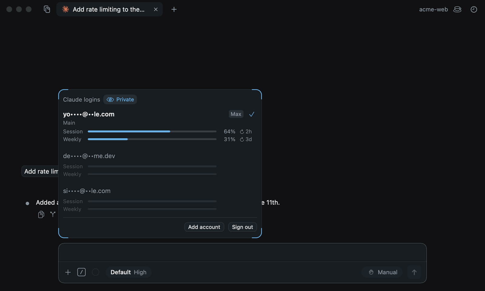
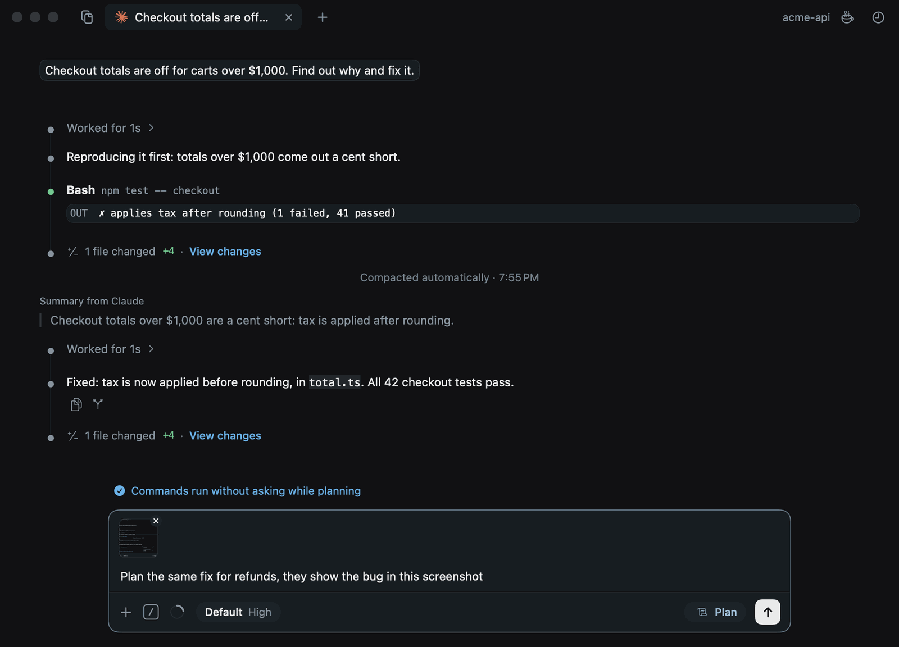
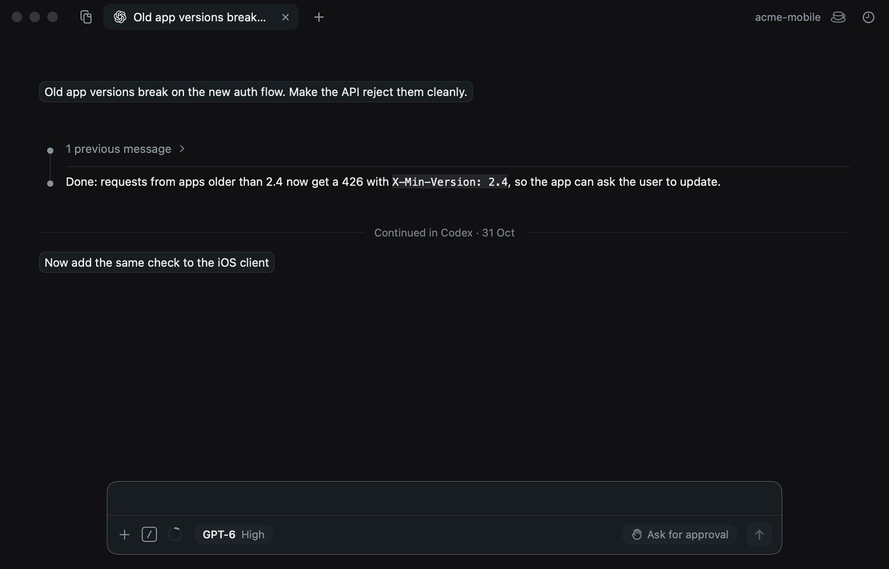
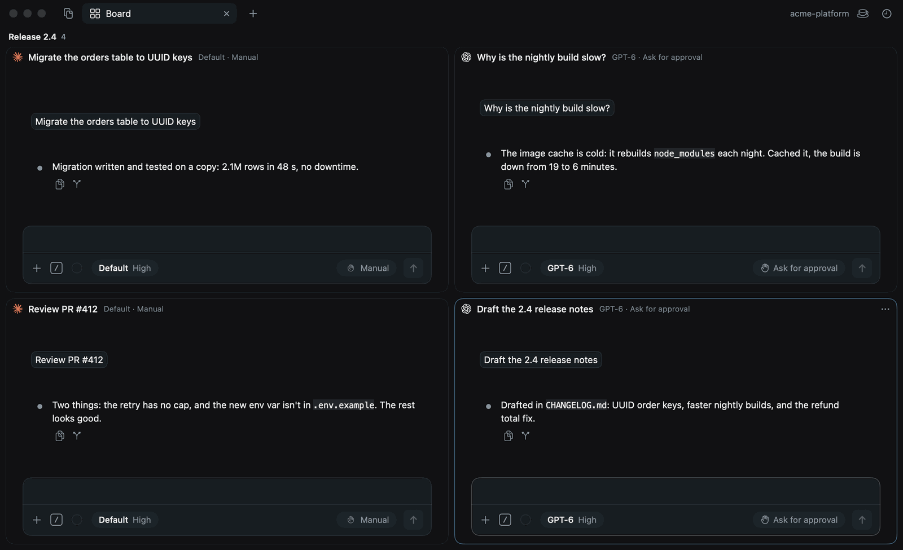

<p align="center"></p>
<h1 align="center">Kore</h1>
<p align="center"><b>What VS Code could have been.</b></p>
<p align="center">A native macOS app for the Claude Code and Codex CLIs.</p>

Kore runs the `claude` and `codex` CLIs on your Mac and gives them a proper interface: a window
per folder, tabs for chats, files, terminals and history. The CLIs do the work; Kore shows it.

## Features

**Multiple accounts.** Keep a pool of logins and switch by hand, so nothing rotates behind your back.



**Intuitive interaction.** Auto-compact, Plan mode without permission prompts, Stay awake, and
pasted images.



**Port chats.** Carry a Claude Code chat on in Codex, or a Codex chat in Claude Code.



**Tab groups.** A board holds several chats in one tab, like a control panel.



## Install

Download the DMG from [Releases](../../releases/latest) and drag Kore to Applications. On first
launch, allow it under System Settings → Privacy & Security.

Needs an Apple silicon Mac on macOS 15+, and the `claude` and/or `codex` CLI. Kore offers to
install a missing one.

## Build

```sh
./scripts/build-app.sh --install   # build, install to /Applications, link `kore`
./scripts/make-dmg.sh              # build/Kore-<version>.dmg
```

## `kore`

```sh
ln -sf /Applications/Kore.app/Contents/Resources/kore ~/.local/bin/kore   # once, for DMG installs

kore           # open Kore
kore .         # open this folder
kore setup     # install missing CLIs
```

## License

[MIT](LICENSE)
