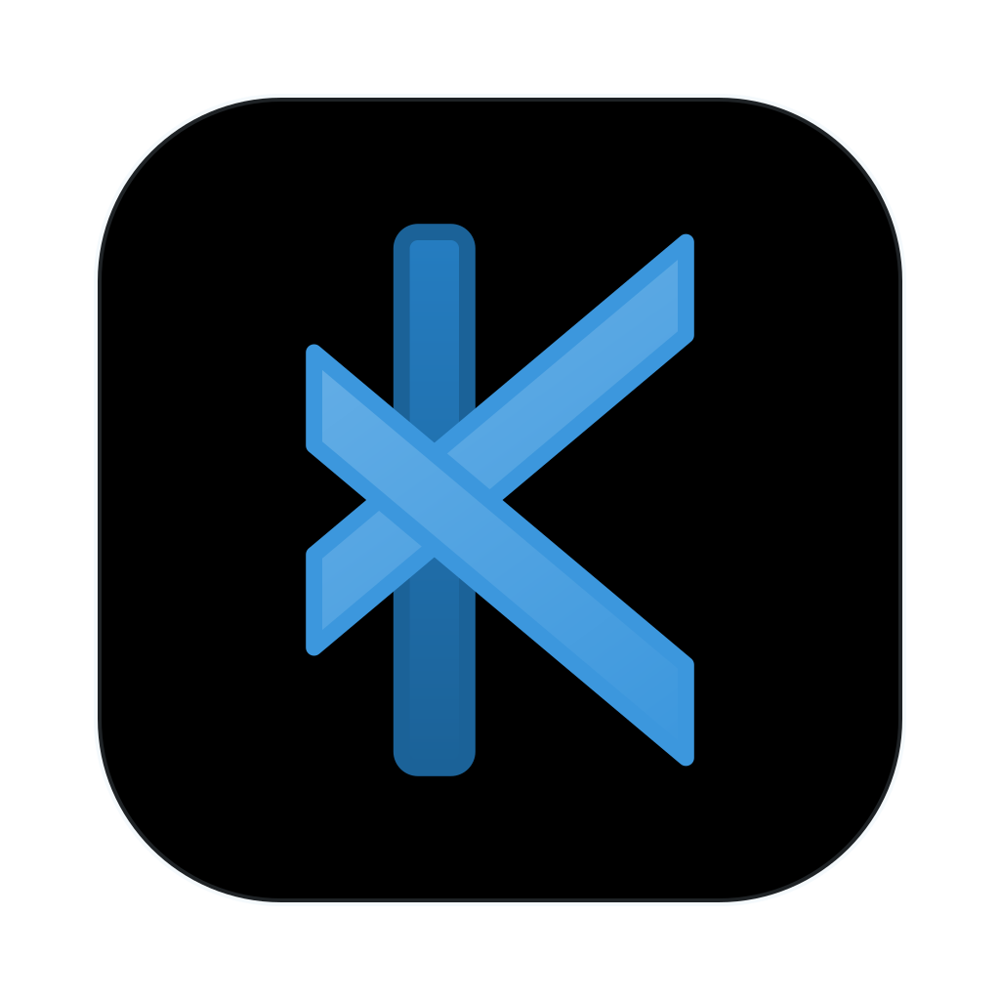

<p align="center">
  
</p>

<h1 align="center">Kore</h1>

<p align="center">
  A native macOS app for the Claude Code and Codex CLIs.
</p>

<p align="center">
  <a href="../../releases/latest">Download</a> ·
  <a href="CHANGELOG.md">Changelog</a> ·
  <a href="LICENSE">MIT License</a>
</p>

---

Kore runs the `claude` and `codex` CLIs on your Mac, signed in with your own accounts, and puts
a proper Mac interface on top of them. The CLIs stay the engine: models, tools, permissions,
`CLAUDE.md` / `AGENTS.md`, MCP, skills, sessions and sign-in are all theirs. Kore spawns them,
speaks their machine protocols, and renders the result.

Your chats live in the CLIs' own history, not in a Kore database. Kore never handles your
credentials and has no server of its own. A chat started in Kore can be picked up in a terminal
or an editor extension, and the other way round.

## Features

- **One window per folder, tabs for chats.** Each tab is a Claude or a Codex chat. A folder's tabs
  come back the way you left them, and the history clock lists every chat the CLIs have for that
  folder, wherever it was started.
- **The full chat surface.** Streaming answers, tool calls with diffs, approvals, questions, plan
  mode, models and effort, slash commands, queued messages, retry, fork and compaction.
- **Agents and commands.** Sub-agents in a live map; background commands you can watch, send to
  the background or stop.
- **Files.** An explorer with git status, a fast editor (syntax colour, find, folding, go to file,
  autosave), and viewers for Markdown, JSON, CSV, notebooks, Mermaid, PDF, images, media and hex.
- **Boards and terminals.** Lay out chats and files side by side on a board, with a built-in
  terminal underneath.
- **Accounts and usage.** Sign in, sign out and switch accounts for both CLIs, and see plan limits
  and reset times without spending a turn.
- **Move a chat across CLIs.** Continue a Claude chat in Codex, or a Codex chat in Claude.
- **Attachments.** Paste, drop or attach files and images, and mark up an image before sending.

## Install

1. Download `Kore-<version>.dmg` from the [latest release](../../releases/latest).
2. Open it and drag **Kore** into **Applications**.
3. On first launch macOS asks before opening an app from outside the App Store. Open Kore once,
   then allow it under **System Settings → Privacy & Security → Open Anyway**.

Kore requires macOS 15 or later and the `claude` and/or `codex` CLI. If one is missing, a new
tab offers to install it, with the CLI's official installer or with Homebrew or npm when the
Mac has them.

### The `kore` command

Kore ships a small shell command for the terminal:

```sh
ln -sf /Applications/Kore.app/Contents/Resources/kore ~/.local/bin/kore

kore             # opens Kore
kore .           # opens the current folder
kore ~/code/x    # opens that folder
kore setup       # installs whichever of the claude and codex CLIs is missing
```

A folder that's already open has its window brought to the front instead.

## Build from source

Kore is a Swift package built with the Xcode Command Line Tools; no Xcode project is needed.
It requires a Swift 6.2 or later toolchain.

```sh
./scripts/build-app.sh            # build/Kore.app
./scripts/build-app.sh --install  # also installs to /Applications and links `kore`
./scripts/make-dmg.sh             # build/Kore-<version>.dmg
```

## How it works

```
Kore.app ─ KoreUI      windows, chats, files, boards, accounts (SwiftUI + AppKit)
              │
           KoreCore    CLI sessions, history, git, files (no UI)
              │
      ┌───────┴────────┐
  claude -p        codex app-server
  stream-json      JSON-RPC over stdio
```

| Target | What it is |
|---|---|
| `KoreCore` | Talks to the CLIs, reads their history, and does the git and file plumbing. |
| `KoreUI` | The app itself: windows, chats, composer, files, boards, accounts. |
| `Kore` | The app's entry point. |
| `kore-cli` | A terminal client over `KoreCore`, for exercising the wiring without the UI. |
| `KoreStorylines` | End-to-end user flows, played against the real app. |
| `kore-fake-cli` | Plays recorded CLI sessions back as `claude` / `codex`, for tests. |

Building, testing and the project's conventions are in [CONTRIBUTING.md](CONTRIBUTING.md).

## License

[MIT](LICENSE). Bundled third-party code is listed in
[THIRD_PARTY_NOTICES.md](THIRD_PARTY_NOTICES.md).
